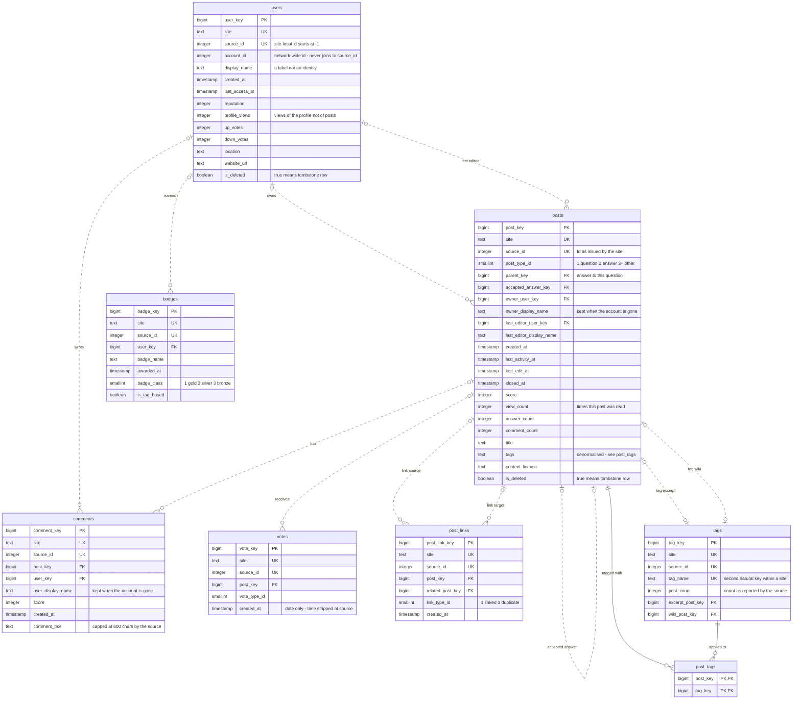

# Entity relationship diagram — `core`

Generated from the database catalogue, not drawn. Every line below is a declared
foreign key in `core`, and every cardinality comes from the nullability of the
referencing column.

## How to read it

Crow's foot notation. The marker nearest an entity says how many of **that**
entity take part. Each marker is two characters: the outer one is the maximum,
the inner one is the minimum.

| marker | means |
|---|---|
| `\|\|` | exactly one |
| `\|o` | zero or one |
| `o{` | zero or more |
| `\|{` | one or more |

A **solid line** is an identifying relationship: the child cannot exist without
the parent, because the parent's key is part of the child's own primary key.
A **dashed line** is non-identifying: the child has its own independent key.

Only `post_tags` is identifying. Every other table carries its own surrogate key.

## The diagram



## What the diagram says that a table list does not

**Almost every relationship is optional.** `|o` rather than `||` on the parent
side of twelve of the fourteen keys. That is not sloppiness — it is the deleted
account and deleted post problem drawn accurately. A post may have no author. A
comment may have no author. The schema has to permit it, so the diagram shows it.

**`post_tags` is the only solid line.** Its two foreign keys are also its primary
key, so a row cannot exist without both parents. That is what an identifying
relationship means, and it is why the junction table needs no surrogate key.

**`posts` points at itself twice.** `parent_key` links an answer to its question.
`accepted_answer_key` links a question to the answer it accepted. A hierarchy and
a one-to-one, in the same table.

**`tags` carries two unique constraints.** `(site, source_id)` and
`(site, tag_name)`. Mermaid marks both with `UK` and cannot show that they are
separate constraints.

**`posts.tags` is a deliberate denormalisation.** The normalised form is
`post_tags`. The string is kept beside it so any row can be traced back to the
dump without a join. It is never read by analysis.

## Regenerating this

```sql
SELECT src.relname, con.conname, con.contype, pg_get_constraintdef(con.oid)
FROM pg_constraint con
JOIN pg_class     src ON src.oid = con.conrelid
JOIN pg_namespace ns  ON ns.oid = src.relnamespace
WHERE ns.nspname = 'core' AND con.contype IN ('f','p','u')
ORDER BY src.relname, con.contype DESC, con.conname;
```

Use `pg_catalog`, not `information_schema`. A read-only role sees no rows in
`information_schema.table_constraints`, because that view requires a privilege
other than `SELECT`.
